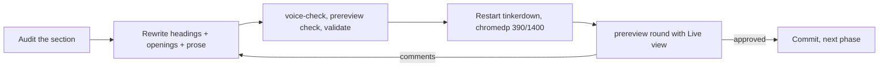

# Docs-native rewrite (M1)

Rewrite the headings and prose of the 66 docs-native pages the way the landing
page was rewritten in #165: plain feature labels, openings that say what
the reader will do, one word per concept. Demos, code, slugs and nav stay. The 29
mirrored pages are M2, planned once M1 lands. Restyling the docs pages
(`mockups/docs-page.html`) is a separate plan; see § Known gaps.

## State

Done: landing rewrite, prev/next nav fix and `VOICE.md` heading rule (#165, open).
Plan approved in prereview 2026-11-28. Next: Phase 0.

## Decisions

- Headings are plain labels for what the section shows: sentence case, two to
  six words, no full stop. "One model, every surface" becomes "How a page
  updates"; "A note on trust" becomes "Validation on the server".
  alternative: keep claim headings and only fix the opaque ones
  because: Livewire, Phoenix, htmx and Fiber all title sections this way, and the
  landing rewrite under this rule was accepted (#165, § Research).
- Each page opens by saying what the reader will build or learn. Background and
  history move below the first demo or code sample, or go.
  alternative: none considered
  because: 4 recipe indexes open with "Most frameworks…" background
  (counter/index.md:10, todos/index.md:10, login/index.md:10,
  progressive-enhancement/index.md:10).
- Keep every demo, code sample, embed, slug, URL and nav entry. Change words only.
  alternative: merge the duplicate pages in this milestone
  because: e2e asserts structure and nav titles, and merges move URLs. Duplicates
  are tracked in § Open questions.
- A page's H1, its front-matter `title:` and its nav entry say the same thing.
  The nine pages where they disagree or carry a teaser change as § H1 changes
  lists. Every other H1 stays.
  alternative: sentence-case every H1
  because: VOICE.md treats the H1 as the page name, and `breadcrumb_test.go`
  pins five section-index H1s ("Learn", "App Recipes", "UI Pattern Recipes"…),
  none of which change. VOICE.md's "Title — a sentence-case clause" allowance
  goes, because every clause in use is a teaser.
- The ui-patterns skeleton (`Template` / `Handler & state` / `When to use`) stays.
  Only its five flagged headings change.
  alternative: rename "Handler & state"
  because: VOICE.md: "Fix the prose under it, not the shape."
- One closing section name on every page: `## Next steps`, a list of links with
  one line each. It replaces "What next?", "Where to go next", "Reading list",
  "See also" and "Related".
  alternative: none considered
- One term per concept, the API's word where there is one (§ Terms).
  alternative: none considered
  because: the audit found "pubsub" spelled six ways and "Tier" used for three
  different things.
- Repeated blocks are said once and linked: the pubsub-vs-server-push table
  stays in `pubsub.md` only, and the "Three consequences" block stays in
  `counter/index.md` only.
  alternative: none considered
- `recipes/apps/index.md` loses its leftover README sections (Testing, CI/CD,
  License, the stale "Test all 5 working examples" at :73).
  alternative: none considered
- Each phase is reviewed in prereview with the Live view before the next starts,
  and lands as its own commit on the `docs-native-rewrite` branch.
  alternative: one review at the end
  because: the landing needed three rounds of comments to converge.

## Files

One decision or criterion per group applies to every file in it.

- `content/getting-started/{index,introduction,install,your-first-app,mental-model}.md`
- `content/recipes/{architecture-flow,custom-attributes,formnovalidate,how-this-site-works,live-releases,progressive-complexity-tree,pubsub,server-push,index}.md`
- `content/recipes/{counter,todos,login,progressive-enhancement,shared-notepad}/index.md`
- `content/recipes/apps/*.md` (10 files)
- `content/recipes/ui-patterns/**/*.md` (34 files; 5 heading changes plus prose)
- `content/contributing/examples.md`, `content/guides/index.md`, `content/reference/index.md`
- `VOICE.md`: "Landing headings name the feature" becomes "Headings name the
  feature" and covers every page. "Every heading that ends in a period has to
  earn one" is retired, because no heading ends in a period. The H1 rule drops
  the "Title — clause" form.
- `content/tinkerdown.yaml`: nav titles for the H1 changes in § H1 changes
- `e2e/anchors_test.go` new?: every `](/path#slug)` and `](#slug)` link in
  `content/` resolves to an element id on the rendered page
- `scripts/voice-check.sh`: lower `MAX_PASSIVE` if the rewrite reduces the count

Out: `content/changelog.md` (release history), every page with an upstream `source_repo`.

## Tracker

Assumptions, open questions and risks, in one place.

| Item | Type | Severity | Status |
|---|---|---|---|
| A heading rename breaks a `#slug` link, including one from a mirrored page this repo can't edit. `tinkerdown validate` doesn't check anchors; `content/` has 116 such links. | risk | high | Phase 0 adds `e2e/anchors_test.go` |
| The five pages with no `source_repo` (install, how-this-site-works, live-releases, progressive-complexity-tree, ui-patterns/index) are outside `cmd/sync`'s manifest. | assumption | high | verified 2026-11-28: none is in `source-of-truth.yaml`, and sync writes only manifest files |
| No e2e test asserts on h2 text or lead copy; only section-index h1s (`breadcrumb_test.go:32-37`), the Introduction h1 (`docs_ia_test.go:71`) and nav section titles. | assumption | medium | verified 2026-11-28 by grep of `e2e/` |
| `tinkerdown serve` serves stale renders after content edits, so restart it before every browser check. | assumption | medium | seen 2026-11-28 |
| Merge the two progressive-enhancement pages (apps/ and recipes/), both in nav at tinkerdown.yaml:51 and :73? | question | high | open, after M1 |
| Merge the two flash-messages pages (apps/ and ui-patterns/feedback/)? | question | medium | open, after M1 |
| Move the five Concepts deep-dives (pubsub, server-push, architecture-flow, progressive-enhancement, progressive-complexity-tree) out of `recipes/` to match the nav? Moves URLs. | question | medium | open, after M1 |
| The counter appears three times (your-first-app, apps/counter, counter/index). Keep all three? | question | low | open |
| Copy drifts back to claims in later phases as context fades. | risk | medium | mitigated by each phase's prereview round and the heading grep |
| `TestLargeTable_DeleteLatency_10k` (`examples/patterns`) fails: Chrome times out loading the 10k-row page before the latency check. Fix it on the rewrite branch as a Phase 0 task, or as its own issue and PR? | question | high | open. Fails on `main` at `85b51bf` (run 2026-11-28) and on #165's branch, so the rewrite didn't cause it |

## Acceptance criteria

Each phase:
- [ ] `/simplify` run on the phase's diff.
- [ ] `bash scripts/voice-check.sh` passes.
- [ ] `prereview check <changed files>` reports no `no-announcing-phrases` or
  `say-apps` finding. Sentence-length findings on raw HTML are livetemplate/prereview#298.
- [ ] `tinkerdown validate content/` reports 0 errors.
- [ ] `GOWORK=off E2E_BASE_URL=http://127.0.0.1:8084 go test ./e2e/...` passes.
- [ ] `make sweep SWEEP_URL=http://127.0.0.1:8084` flags no new page.
- [ ] `GOWORK=off E2E_BASE_URL=http://127.0.0.1:8084 go test ./e2e/ -run TestAnchors` passes.
- [ ] Every heading in the phase's files matches the heading decision:
  `grep -nE '^#{2,3} .*\.$' <files>` returns nothing.
- [ ] Reviewer approved the phase in prereview.

Milestone:
- [ ] `grep -rniE 'pub/sub|publish/subscribe' content/{getting-started,recipes}` returns nothing.
- [ ] `grep -rn 'Tier [ABC]' content/{getting-started,recipes}` returns nothing.
- [ ] `grep -rlE '^## (What next\?|Where to go next|Reading list|See also|Related)$' content/{getting-started,recipes}` returns nothing.
- [ ] The stale references are fixed: `sharedAuth` cited from `pubsub.md:95-97`,
  "the landing page's Step 4" at `loading-states.md:64`, the GitHub link for
  progressive complexity at `apps/index.md:28`.

## Constraints

- Never hand-edit a mirrored page (CLAUDE.md). Fix upstream in M2.
- Never put a blank line inside a `<pre>` block on an HTML page.
- H1 text changes break `breadcrumb_test.go` and nav. Rename an H1 only on purpose, with the test updated.
- No first person, no "we" (VOICE.md). Second person for instructions.
- Run the seeded site (tinkerdown v0.4.3 plus `cmd/site` on :9091) for every
  browser check. The PATH `tinkerdown` is a `dev` build that fails on `content/.md`.

## Terms

| Concept | Use | Replaces |
|---|---|---|
| publish/subscribe | pubsub (Pubsub at the start of a sentence or heading) | pub/sub, PubSub in prose, Pub/Sub, publish/subscribe |
| several tabs, one user | sync across tabs | multi-tab sync, peer fan-out, peer refresh |
| several users | sync across users | multiplayer, cross-user real time |
| progressive enhancement modes | WebSocket / HTTP / no JavaScript | Tier A / B / C |
| loading feedback approaches | approach | tier (loading-states.md:14) |
| `lvt-*` usage levels | Tier 1 / Tier 2 (the mirrored guide's words) | unchanged |
| the WebSocket-off app | HTTP only | WebSocket Disabled |

## H1 changes

H1, front-matter `title:` and nav entry all become the "New" text.

| Page | H1 now | Nav now | New |
|---|---|---|---|
| recipes/apps/file-tree.md | File Tree — a template that calls itself | File Tree | File Tree |
| recipes/apps/seat-picker.md | Seat Picker — cross-user real time, standard HTML | Seat Picker | Seat Picker |
| recipes/apps/upload-modes.md | Upload Modes — one input, four destinations | Upload Modes | Upload Modes |
| recipes/apps/ws-disabled.md | WebSocket Disabled | HTTP Only | HTTP Only |
| recipes/counter/index.md | Counter, deeper | Counter (Deep Dive) | Counter (Deep Dive) |
| recipes/todos/index.md | Todos: a real LiveTemplate app | Todos | Todos |
| recipes/shared-notepad/index.md | Shared notepad: BasicAuth + per-user state + explicit peer refresh | Shared Notepad | Shared Notepad |
| recipes/progressive-enhancement/index.md | Progressive enhancement: graceful degradation | Transports & Progressive Enhancement | Transports & Progressive Enhancement |
| recipes/ui-patterns/navigation/tabs.md | Tabs (HATEOAS) | Tabs | Tabs |
| recipes/ui-patterns/realtime/multi-user-sync.md | Multi-User Refresh | Multi-User Refresh | Multi-User Sync |

## Phases

### Phase 0: anchor check

Audit: list the 116 `#slug` links in `content/` and which rendered pages they target.
Implementation: `e2e/anchors_test.go` loads each target page once and checks every
linked id exists. Fix any link already broken on `main`, so later failures mean
a rename broke it.
Acceptance: the test passes on the rewrite branch before Phase 1 starts.
Learn: —

### Phase 1: getting-started (5 pages)

Audit: re-read the 5 pages against § Terms. `your-first-app.md:117` puts
`lvt:session:<groupID>` and "ACL-exempt" in a first tutorial.
Implementation: headings ("When LiveTemplate fits" becomes "When to use it"),
openings, the announcing lines (install.md:8, :16, your-first-app.md:41, :104),
and getting-started/index.md:12-17, which repeats introduction.md:47-51.
Acceptance: § Acceptance criteria, each phase.
Learn: —

### Phase 2: recipe deep-dives (9 top-level pages)

Audit: architecture-flow.md repeats mental-model.md:44-89. Decide which keeps it.
Implementation: architecture-flow's numbered sentence headings become labels,
plus pubsub, server-push and formnovalidate, how-this-site-works ("The shape of
the dogfood loop"). Fix the `sharedAuth` reference.
Acceptance: as above.
Learn: —

### Phase 3: recipe indexes (5 pages)

Audit: the shared skeleton (intro, walkthrough, "Where this recipe stops",
"What next?"). Keep the skeleton and rename its closing to `Next steps`.
Implementation: openings, the first person in counter/index.md:43, and the
dramatic lines (:107, :113, todos:46, :93, progressive-enhancement:116).
Acceptance: as above.
Learn: —

### Phase 4: apps (10 pages)

Audit: two templates (README-style and narrative). Pick one closing per template.
Implementation: the four apps rows in § H1 changes, the claim headings (seat-picker,
file-tree, upload-modes), cut the README leftovers in apps/index.md.
Acceptance: as above.
Learn: —

### Phase 5: ui-patterns and single pages (37 pages)

Audit: confirm only the five flagged headings break the rule.
Implementation: the two ui-patterns rows in § H1 changes, "Client-owned or
server-owned?" becomes "Choosing an approach", the "Step 4" link. Prose passes on all 33 pages.
contributing/examples.md opens with what the page is for and moves the archive
history below it.
Acceptance: as above, plus the milestone criteria.
Learn: —

## Known gaps

- Mirrored pages keep the old register until M2 lands upstream and a release syncs them.
- Restyling the docs pages (the original request was "rewrite and restyle";
  `mockups/docs-page.html`, `docs-home.html`) has no plan yet. M1 changes words only.
- `docs/proposals/docs-quality-roadmap.md` (untracked, status Proposed) covers IA,
  reference splitting and version metadata, not copy. M1 overlaps it only on the
  homepage comparison (its § 7), which the landing rewrite already has.

## Research

Section headings on comparable docs, read 2026-11-28:
- [Livewire quickstart](https://livewire.laravel.com/docs/quickstart): "Prerequisites", "Install Livewire", "Create a layout", "Next steps"
- [Livewire forms](https://livewire.laravel.com/docs/forms): "Submitting a form", "Adding validation", "Showing a loading indicator", "See also"
- [Phoenix LiveView welcome](https://phoenix-live-view.hexdocs.pm/welcome.html): "What is a LiveView?", "Example", "Bindings", "Navigation"
- [htmx examples](https://htmx.org/examples/): a table of pattern name and "Demonstrates …"; [Click to Edit](https://htmx.org/examples/click-to-edit/) opens with one sentence on the pattern
- [Fiber docs](https://docs.gofiber.io/): "Installation", "Hello, World", "Basic Routing", "Next Steps"
- Landing pages, for the landing rewrite: [htmx](https://htmx.org/), [Hotwire](https://hotwired.dev/), [Livewire](https://livewire.laravel.com/), [Datastar](https://data-star.dev/), [Phoenix](https://www.phoenixframework.org/), [templ](https://templ.guide/), [Alpine](https://alpinejs.dev/), [Fiber](https://gofiber.io/)
